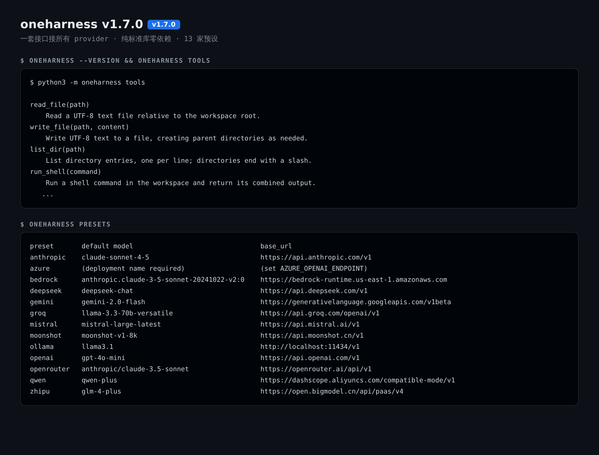
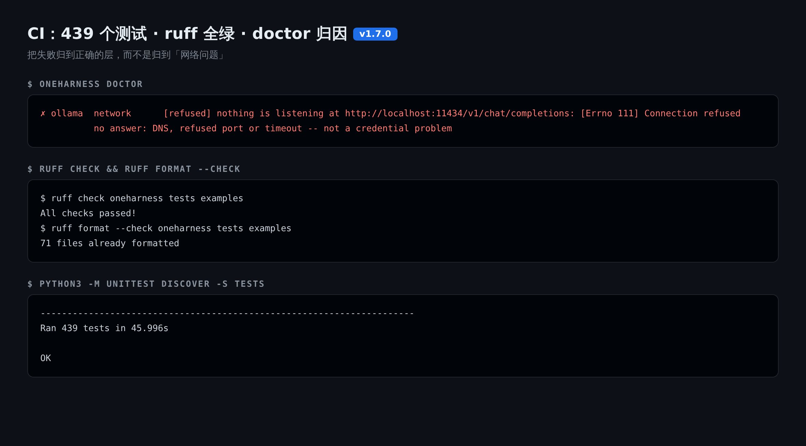
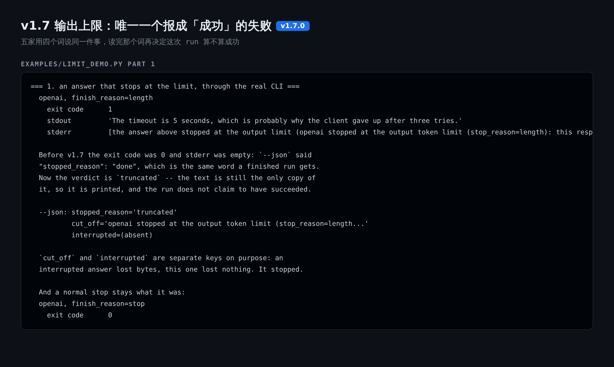
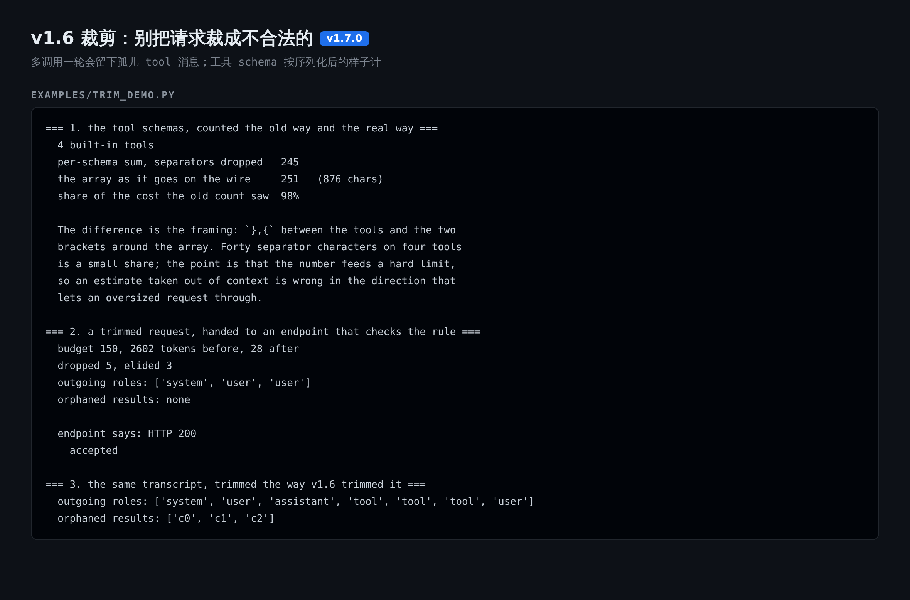
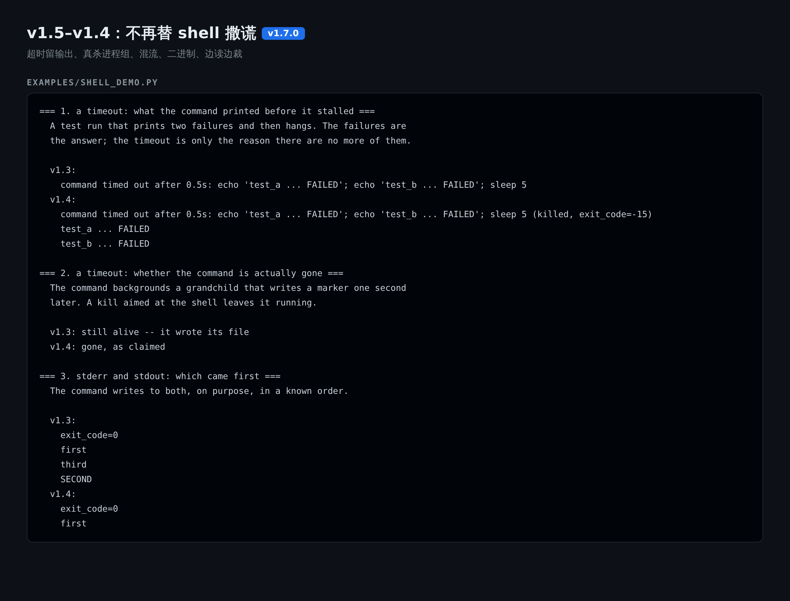
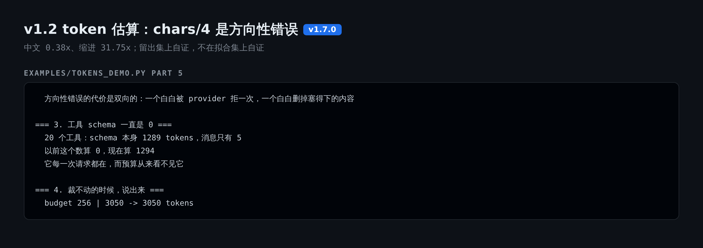
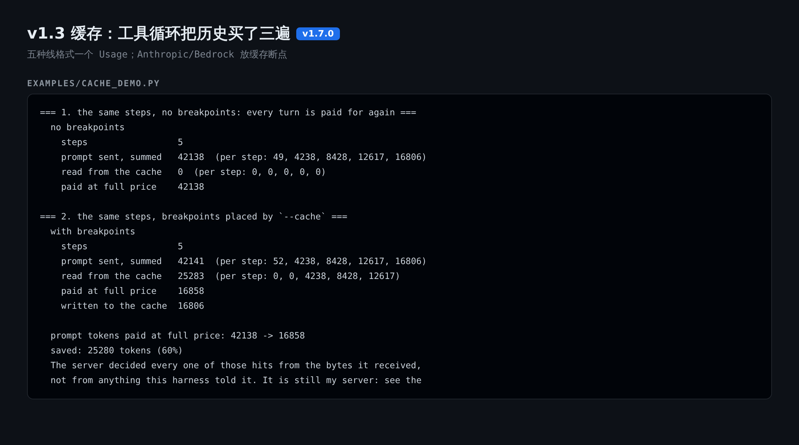

# OneHarness

给工具调用型 LLM agent 用的一层薄 harness：**一套接口，接所有 provider**。

不引入任何第三方依赖（纯标准库），也不试图做成框架。它只做十四件事：

1. 把 OpenAI / Anthropic / Gemini / Bedrock / Azure 五种线格式抹平成同一个 `Completion`——
   包括 Bedrock 的请求签名和二进制流；
2. 跑「模型要调工具 → 执行 → 结果回灌 → 再问」这个循环，且不让工具的错误炸掉循环；
3. 支持流式输出：token 边生成边出，工具调用在**参数还在到达时**就可见，连接断了也留住
   已经收到的半句；
4. 一轮里的多个工具调用可以并发跑，也可以把整个任务丢给带全新上下文的子 agent ——
   包括一次派出去好几个；
5. 用 TOML + 环境变量管配置，用一条命令跑起来，还能顺手接管 MCP server 的工具；
6. 能把一个越跑越长的工具循环塞进模型的窗口：超了就在发请求前裁，裁完还是超就
   按 provider 的原话降预算重试，实在没得裁就停手说清楚；
7. 能验证自己：`doctor` 用真 provider 各发一次最小请求并**判断是谁的错**，
   请求层可 `--record` / `--replay` 成 tape，回放不需要 key 也不需要网络；
8. 能说清慢在哪：`--timing` 把每一步拆成「等模型」和「等工具」，并给出首 token 时间；
9. 不把网络故障丢给上层：连接被掐断、body 比声明短、`Retry-After` 要你等——都收敛成
   自己的错误类型和一句能读的话，退避也照对方说的等；而且**说清是哪种没答**：证书被拒、
   代理要密码、域名解析不了、端口没人听，四种「没答」四种修法；
10. 数得清一个请求有多大：按字符类别估算 token 而不是 `chars / 4`（中文差 2.6 倍、
   缩进差 32 倍），把工具 schema 也算进去，裁不动的时候如实说还差多少；
11. 知道哪些 token 是打折的：五种线格式的缓存字段各不相同（有的含在 prompt 里、
   有的不含），统一成一个 `Usage` 再报出来，Anthropic / Bedrock 还能顺手放好
   缓存断点——工具循环每一步都重发整个历史，那两个 provider 不放就是每一步全价；
12. 不替 shell 撒谎：超时了也把已经打印出来的东西带回来，说杀了就真的杀掉整棵
   进程树，`stderr` 和 `stdout` 按真实顺序混在一条管道里，二进制输出不当异常，
   刷屏的输出边读边裁（保留头尾）；
13. 不把「服务器死了」报成「超时了」：MCP server 崩了立刻说崩了、带上它自己那句
   遗言，还顺手回它发过来的请求；`close()` 等的是关掉，不是等它自己走；
14. 不把「模型话没说完」报成「答完了」：五家用四个词说同一件事（`length` /
   `max_tokens` / `MAX_TOKENS`），读完那个词再决定这次 run 算不算成功。

```console
$ oneharness run "看看 examples/app.conf 里的 timeout，太小了就改大"
  → read_file({"path": "examples/app.conf"})
  ✓ read_file: timeout=5
  → write_file({"path": "examples/app.conf", "content": "timeout=30\n"})
  ✓ write_file: wrote 11 chars to examples/app.conf
timeout 原来是 5，我改成了 30。
```

## 为什么需要它

每个 provider 的差异都琐碎但要命：工具调用参数是 JSON 字符串还是对象、tool 结果挂在
哪个字段、system prompt 是消息还是独立字段、usage 字段叫什么、429 该不该重试。
OneHarness 把这些差异收敛在 `providers/` 里，上层只有一个 `Provider.complete()`。

```python
from oneharness import Agent, Registry, create_provider, tool


@tool
def add(a: int, b: int) -> int:
    """把两个整数相加。"""
    return a + b


agent = Agent(create_provider("openai", model="gpt-4o-mini"), Registry([add]))
result = agent.run("37 加 58 等于多少？")
print(result.text)
```

`@tool` 直接读函数签名和类型注解生成 JSON Schema，不用手写 schema 字符串：

```python
@tool
def search(query: str, mode: Literal["fast", "deep"] = "fast", tags: list[str] = []) -> dict:
    """搜索文档。"""
```

## 安装

```console
$ pip install -e .          # 需要 Python 3.11+
$ oneharness --help
```

## 命令行

| 命令 | 作用 |
|---|---|
| `oneharness run "<prompt>"` | 跑一个 prompt，打印最终回答 |
| `oneharness chat` | 多轮交互会话，保留历史 |
| `oneharness tools` | 列出内置工具及其参数 |
| `oneharness presets` | 列出 provider 预设、默认模型和端点 |
| `oneharness doctor` | 对真 provider 各发一次最小请求，判断配置/密钥/模型哪一层出问题 |
| `oneharness config` | 打印解析后的配置（排查配置问题用） |

常用参数：

```console
$ oneharness run "修复测试" --workspace . --shell --max-steps 12
$ oneharness run "ping" --provider deepseek --model deepseek-chat --json
$ oneharness run "ping" --no-tools --quiet
$ oneharness run "看看这个仓库" --stream
$ oneharness run "整理这次改动" --delegate --parallel 4
$ oneharness run "查一下今天的文件" --mcp "npx -y @modelcontextprotocol/server-filesystem ."
$ oneharness run "读一遍整个仓库" --context-budget 32000   # 单个请求的 token 上限
$ oneharness run "整理这次改动" --cache --provider anthropic  # 放缓存断点，历史只付一次
$ oneharness run "ping" --record run.json     # 把这次的所有请求存成 tape
$ oneharness run "ping" --replay run.json     # 不联网、不需要 key，重放同一次
$ oneharness run "整理这次改动" --timing       # 每步拆成「等模型」和「等工具」
```

`--json` 输出稳定的机器可读结构，适合挂到脚本里：

```json
{
  "text": "pong",
  "stopped_reason": "done",
  "model": "deepseek-chat",
  "usage": {"input_tokens": 24, "output_tokens": 2, "total_tokens": 26},
  "steps": [
    {"text": "pong", "tool_calls": [], "tool_results": [], "usage": {...},
     "seconds": 0.61, "model_seconds": 0.61, "tool_seconds": 0.0}
  ],
  "timing": {"total_seconds": 0.62, "model_seconds": 0.61, "tool_seconds": 0.0, "...": "..."}
}
```

`--json` 与 `--delegate` 可以一起用：子 agent 的 token 单独打到 stderr，stdout 保持是纯 JSON，
并且多出一个 `delegation` 字段（`seconds` 是子 agent 花掉的墙钟，会话总时间对得上）：

```json
{
  "text": "...",
  "delegation": {
    "runs": 3,
    "seconds": 1.84,
    "usage": {"input_tokens": 1260, "output_tokens": 174, "total_tokens": 1434},
    "by_label": {"sub-1": {"input_tokens": 420, "output_tokens": 58, "total_tokens": 478}}
  }
}
```

父 agent 没有委派时这个字段不出现——空对象比缺字段更容易让人以为坏掉了。

退出码：`0` 正常收尾，`1` 配置/网络/工具链出错、步数耗尽或回答撞上输出上限，
`2` 参数错误（argparse 惯例）。

## 流式输出

`--stream` 让 token 一边生成一边打印，但结果结构和非流式完全一样：工具循环仍在跑，
`--json` 也照常可用（`--json` 与 `--stream` 同时给时以 JSON 为准）。

```console
$ oneharness run "把两个配置文件都改一下" --stream
  … write_file#0({"path":…
  … write_file#1(…
  … write_file#0( "a.conf",…
  … write_file#1({"path":…
  … write_file#0( "content": "timeout=30\n"}…
  … write_file#1( "b.conf", "content": "retries=3\n"}…
  ✓ write_file: wrote 11 chars to a.conf
  ✓ write_file: wrote 10 chars to b.conf
Two files to fix. Both written. a.conf gets timeout=30, b.conf gets retries=3.
```

三个 provider 都实现了真正的 SSE 解析。细节上各有各的坑，都收在 provider 里：

- OpenAI 的工具调用参数是**跨多个 chunk 的 JSON 片段**，按 `index` 归并后一次性解析；
- Anthropic 的工具输入走 `input_json_delta`，同样要拼；`input_tokens` 在
  `message_start` 里、`output_tokens` 在 `message_delta` 里，分两处取；
- Gemini 走 `streamGenerateContent?alt=sse`，函数调用以完整对象出现，不需要拼。

如果某个 provider 没实现 `stream()`，基类会退化成「一次性发完」，`--stream` 依然能用。

### 工具调用在写完之前就露面

上面的 `… write_file#0(...)` 是**参数还在到达时**就画出来的那一行，不是等工具跑完才补的。
`#N` 是 provider 自己的 `index`：同一轮里两个调用会交错着拼参数，行首的编号是唯一能分辨
「这个逗号属于谁」的东西。

以前做不到这件事：完整参数只存在于 `done` 事件里，于是「有个 `write_file` 要来了」这条信息
总是在模型把两 KB 正文写完**之后**才出现——正好是它失去价值的那一刻。现在 `StreamEvent`
多了一种 `tool`（`text` / `tool` / `done`），CLI 相应多一个 `tool_call_delta` 事件：

```json
{"type": "tool_call_delta", "step": 1, "index": 0, "id": "call_a", "name": "write_file", "fragment": "{\"path\":"}
```

`fragment` 为空表示「这个调用存在，参数还没有」。把同 `index` 的 `fragment` 依次接起来
就是最终的参数 JSON——所以它既是给人看的进度，也是一份能自己拼的增量流。

三个适配器各有各的时机，因为各家的帧结构不同：OpenAI 的名和参数挤在同一个 `tool_calls`
delta 里，Anthropic 在 `content_block_start` 就给了 id 和 name（参数一个字节都还没有），
Gemini 则是一个完整对象、没有增量可言。

### 流断了，半句话还在

连接中途断掉（超时、代理掐了、服务器崩了）时，已经收到的文本不会被丢掉：

```console
$ oneharness run "..." --stream
  ! stream ended without a final completion -- kept 38 chars it had already said
Two files to fix. Both written. a.conf gets timeout=30,
[the answer above is incomplete]
```

`stopped_reason="interrupted"`，`--json` 里多一个 `interrupted` 字段写原因，退出码 1。
Ctrl-C 同理，只是原因写作 `interrupted by user (Ctrl-C)`、退出码 130——和 shell 对 Ctrl-C
的约定一致，`oneharness run ... && ...` 才不会把「人主动停了」当成成功。

这条不对称是刻意的：**非流式没有半句话可言**，body 没解析出来就是没有，仍然抛异常。
流式之所以能留住，是因为那些字节已经真的到了。

判断「断了」的依据是 provider 自己的收尾标记，不是「读完了」：OpenAI 的 `finish_reason`、
Anthropic 的 `stop_reason`、Bedrock 的 `messageStop`、Gemini 的 `finishReason`。少一个都算截断——
适配器不再替服务器编一个「正常结束」，因为它不知道那是不是正常结束。

## 输出上限：唯一一个报成成功的失败

模型的话说到一半被自己的输出预算切断，是最安静的一种失败。把它和这个仓库前几个版本修过的
失败摆在一起，它是唯一一个**每一层都是对的**：

| 失败 | 谁能看出来 |
|---|---|
| 流断在半句 | `truncated`（v0.8 起留住半句） |
| 连接被掐断 | `NetworkError`，带 kind |
| 请求太大被拒 | `context overflow`，会降预算重试 |
| **输出撞上限** | HTTP 200、JSON 合法、流走到收尾标记、`stopped_reason="done"`、退出码 0 |

五家用四个词说同一件事，而且没有别的信号可言：

| provider | 字段 | 值 |
|---|---|---|
| OpenAI / DeepSeek / Groq | `finish_reason` | `length` |
| Anthropic | `stop_reason` | `max_tokens` |
| Gemini | `finishReason` | `MAX_TOKENS` |
| Bedrock | `stopReason` | `max_tokens` |

以前这些词被存进 `Completion.stop_reason`，然后没有任何人读。循环只问「它有没有要工具」，
于是**一个完整的响应**被当成了**一个完整的回答**。

```console
$ oneharness run "为什么客户端三秒就放弃了？"
The timeout is 5 seconds, which is probably why the client gave up after three tries.
[the answer above stopped at the output limit (openai stopped at the output token limit (stop_reason=length): this response is complete as a response and unfinished as an answer)]
$ echo $?
1
```

判定放在适配层：只有适配器认识那个词。`Provider._finish(completion, reason)` 把
`stop_reason` 和「要不要 `cut_off`」一起定下来，五家各自调用一次，循环什么都不用知道。

`--json` 里它是**独立字段**，不和 `interrupted` 合并：

```json
{
  "text": "The timeout is 5 seconds, which is probably why the client gave up after three tries.",
  "stopped_reason": "truncated",
  "cut_off": "openai stopped at the output token limit (stop_reason=length): this response is complete as a response and unfinished as an answer"
}
```

两个键分开是有理由的：`interrupted` 的意思是**丢了字节**，`cut_off` 的意思是**什么都没丢，
只是停在了预算边上**。合成一句话，修法就错了——一个去查网络，一个去调 `max_tokens`。

### 半个工具调用也执行

输出在上限处切断时，模型可能正写到 `write_file` 的参数中间。这一条更难办：调用不能扔。
一条声明了 `tool_calls` 却没有对应 `tool` 消息的 assistant 消息，每家 provider 都会拒绝，
扔了就等于把整个请求也扔了。所以它照常执行，只是**参数被标成不完整**：

```console
  → write_file({"path": "app.conf", "content": "timeout=30
retries=
  ! write_file: error: tool arguments were cut off by the output limit
[the answer above stopped at the output limit (...)]
```

标记而不是猜测：判据是那段 JSON **解不解析得出来**。`{"path": "app.conf"` 只差一个右括号，
而 `{"path": "x"}` 是解出来的——按长度猜会把后者也判成坏的，把一次能用的请求变成一次报错。
stream 路径和一次性响应走同一段代码（`mark_incomplete_arguments`），所以两条路上的结论一致。

然后这一轮跑完就停：下一步要请求模型「接着刚被打断的那句话往下写」，而那是一个它没有预算
继续的东西。

`examples/limit_demo.py` 四段都是真跑的：真 CLI、真 SSE 服务器，服务器的最后一帧就是
`finish_reason: length` 本身。**旧版本**的结论写在第 1 段的注释里——这是少数几个没法用
「新旧实现同进程对照」演示的改动，因为旧版的表现就是「一切正常」。

## MCP

MCP server 本质是「一个说 JSON-RPC 的子进程」，用标准库就能说完，所以没有引依赖。
`oneharness` 只实现 tools 这一层（`initialize` / `tools/list` / `tools/call`）——resources 和
prompts 目前对 agent 循环没有用，写了也是死代码。

```console
$ oneharness run "读一下 /tmp/notes.md" \
    --mcp "npx -y @modelcontextprotocol/server-filesystem /tmp"
  + mcp npx: read_file
  + mcp npx: list_directory
  → read_file({"path": "/tmp/notes.md"})
  ✓ read_file: # 备忘 …
```

也可以写在配置里，长期生效：

```toml
[[mcp]]
command = ["npx", "-y", "@modelcontextprotocol/server-filesystem", "/tmp"]
prefix = "fs."     # 可选；两个 server 有同名工具时用它区分
```

两条硬规矩：

- **MCP 工具报错不炸循环。** 服务器返回 `isError` 时转成 `ToolResult(is_error=True)`，
  让模型看到原因自己换路数；只有连接断了、握手超时这种才抛。
- **工具名撞车在启动时就报错**，不会留到运行中途才 ambiguous。服务器在 run 结束时一定被关掉，
  异常路径也一样。

### 「没答」和「死了」不是一件事

v1.4 的客户端对每一种失败都只有一句话：*did not answer in 30s*。而一个 `KeyError:
'database_url'` 退出的服务器从不说一个字——于是客户端等满了超时，然后把锅甩给时钟，
把那段 traceback（唯一说清该修什么的东西）收进一个列表然后没人读过。

```console
v1.4  30.00s  MCP server did not answer initialize in 30.0s
now    0.05s  MCP server 'python3' exited with code 3 before answering initialize;
              last stderr: Traceback (most recent call last): | ... |
              ValueError: MISSING_TOKEN is not set
```

三种表现，`examples/mcp_health_demo.py` 里逐条对照：

**1. 崩在手握手里。** 进程 0.05 秒前就退出了，理由写在 stderr 上，而客户端还在等。

**2. 崩在一次工具调用里。** 同一个形状，只是 run 已经跑起来了。旧版把这次崩溃报成
`did not answer tools/call in 10s`——一个关于崩溃的超时故事，模型据此会去重试一个永远
不会回来的服务器。现在它是 `ToolResult(is_error=True)`，带着退出码和最后几行 stderr，
循环不炸，模型自己能决定换条路。

**3. 服务器发来一个 `ping`。** 协议是双向的：服务器可以发请求并等你回。旧版把没有
自己 id 的消息全部丢掉，于是两个进程互相等着——而客户端把这个僵局叫做「超时」。
现在 `ping` 回 `{}`，别的方法回 `-32601`（明说不支持，比沉默好）。

判断「死了」不靠时钟靠管道：stdout 读到 EOF 就是「从这一刻起它不会再有答案」，接着
`poll()` 拿退出码、把 stderr 最后三行带上。所以上面那些数字是 0.05s，不是 30s。

### `close()` 等的是关掉，不是等对方自己走

服务器如果包了另一个进程，那个孙子会继承 stdout。杀掉服务器之后孙子还在、管道还开着、
读线程还阻塞在 `read()` 里——而旧版 `close()` 是**从另一个线程关掉那个被读的流**，
`close()` 会等这把锁，于是关服时间等于孙子的寿命：

```console
子进程活 10 秒
  v1.4  10.00s  close() 把它整个寿命等完了
  now    0.00s  立刻返回，孙子也没了
```

现在服务器起在自己的会话里（`start_new_session=True`），关服按进程组 `SIGTERM` →
`SIGKILL`；读线程自己拥有并关闭自己的流，别的线程不碰。这也是 `run_shell` 在 v1.4
学的同一课：**「说杀了」的意思必须是杀掉了**，而不是「我发了个信号」。

## 子 agent

`--delegate` 把 `delegate(task)` 交给模型。子 agent 有同样的工具、自己的 system prompt、
自己的消息列表——**父 agent 只看到最后一句结论**，中间那二十次读文件永远不会进父的上下文。

```console
$ oneharness run "看看这个仓库的超时配置合不合理" --delegate
  → delegate({"task": "读取 app.conf 和 notes.md，告诉我超时配了多少"})
  [sub-1] ⇢ 读取 app.conf 和 notes.md，告诉我超时配了多少
      [sub-1] → read_file({"path": "app.conf"})
      [sub-1] ✓ read_file: timeout=5
      [sub-1] → read_file({"path": "notes.md"})
      [sub-1] ✓ read_file: - 5 秒对真实请求太短 - 目标是 30 秒
  [sub-1] ⇠ done: 3 step(s), 660 tokens
  ✓ delegate: app.conf: timeout=5；notes.md 里写着 5 秒对真实请求太短。结论：需要调大。
[delegated 1 task(s): 580 in / 80 out tokens]
```

三件事值得说明：

- **子 agent 不能再委派。** `delegate` / `delegate_many` 在建子 agent 时就被剔除了，
  递归深度靠结构保证，不靠一个没人检查的计数器。
- **花费单独记账。** 上面那行 `[delegated ...]` 是子 agent 自己的 token 数，不并进父 agent 的
  `result.usage`。「父花了 2 分、子花了 3 毛」是个应该能看见的事实。
- **子 agent 没答案不算成功。** 它烧完 `max_steps` 还是没给结论时，父 agent 收到的是一条
  `is_error=True` 的工具结果（不是异常），可以自己决定换路数。

也可以只用一个工具，不接管 CLI：

```python
from oneharness import Agent, Delegator, Registry, create_provider, default_tools

provider = create_provider("openai")
delegator = Delegator(provider, default_tools("."), max_steps=6, max_parallel=4)
agent = Agent(provider, Registry([*default_tools("."), delegator.tool(), delegator.batch_tool()]))
print(agent.run("把 README 的错别字都找出来改成 PR").text)
print(delegator.as_dict())  # {"runs": 3, "usage": {...}, "by_label": {...}}
```

## 一次派好几个子 agent

`--delegate` 同时给出 `delegate_many(tasks)`：一个工具调用，N 个子 agent，**一次 spawn 完**。
它和在一个回合里连调三次 `delegate` 的区别不是写法好看，而是那三次调用能不能重叠——
`--parallel` 管的是同一轮的工具调用，所以 `delegate` 攒一批才会有意义。

```console
$ oneharness run "同时查这三件事，最后汇总" --shell --delegate --parallel 3
  → delegate_many({"tasks": ["app.conf 里的 timeout 是多少？", ...]})
  [sub-1] ⇢ app.conf 里的 timeout 是多少？
  [sub-2] ⇢ notes.md 里的结论是什么？
  [sub-3] ⇢ README 有没有提到 0.4？
      [sub-3] → run_shell({"command": "sleep 0.7 && cat README.md"})
      [sub-2] → run_shell({"command": "sleep 0.7 && cat notes.md"})
      [sub-1] → run_shell({"command": "sleep 0.7 && cat app.conf"})
      [sub-3] ✓ run_shell: exit_code=0 # demo  版本 0.3.0
      [sub-1] ✓ run_shell: exit_code=0 timeout=5
      [sub-2] ✓ run_shell: exit_code=0 - 5 秒对真实请求太短
  [sub-3] ⇠ done: 2 step(s), 478 tokens
  [sub-1] ⇠ done: 2 step(s), 478 tokens
  [sub-2] ⇠ done: 2 step(s), 478 tokens
  ✓ delegate_many: [sub-1] alpha: 读完了 app.conf [sub-2] beta: ... [sub-3] gamma: ...
[delegated 3 task(s): 1260 in / 174 out tokens]
  sub-1: 420 in / 58 out
  sub-2: 420 in / 58 out
  sub-3: 420 in / 58 out
```

`--parallel 1` 跑 2.19s，`--parallel 3` 跑 0.78s（`examples/fanout_demo.py` 实测）。
三个子 agent 的输出交错在一起时，**行首的 `[sub-N]` 是唯一能分辨谁是谁的东西**，
所以每个 run 都有标签，`--json` 里也有 `delegation.by_label` 的单独账目。

三条规矩：

- **返回顺序 = 请求顺序。** 谁先跑完谁先说会让父模型的上下文每次都不一样，这种噪声没有价值。
- **一个子 agent 失败不沉掉整批。** 那一行写 `[sub-2] failed: ...`，其余答案照常回来。
  父模型能看见谁没成，自己决定要不要补。
- **标签是并发的报警器。** 上一版为了并行委派临时加了锁才发现：`usage = usage + x`
  是读-改-写，40 个并发 run 会静默丢 1000 个 input token。记账加锁不是洁癖，是它真的会掉。

## 并发工具

默认串行——工具没被假定线程安全。要并发就显式给数：

```console
$ oneharness run "把三条命令都跑一遍" --shell --parallel 3
  → run_shell({"command": "sleep 0.9 && echo alpha"})
  → run_shell({"command": "sleep 0.5 && echo beta"})
  → run_shell({"command": "sleep 0.2 && echo gamma"})
  ✓ run_shell: exit_code=0 gamma
  ✓ run_shell: exit_code=0 beta
  ✓ run_shell: exit_code=0 alpha
```

三条刻意错开的 sleep：顺序跑 1.61s，`--parallel 3` 跑 0.91s，而且完成顺序反过来——
这才是「真的同时跑了」而不是「排着队跑完了」的证据（`examples/delegate_demo.py` 实测）。

一个刻意的不对称：**事件按真实完成顺序发出，回灌给模型的结果按模型请求的顺序排列**。
前者是给看日志的人，后者是给模型的可预测性。单个工具失败仍然只影响自己那一格，
不影响同批的其他工具，也不炸循环。

## Bedrock

Bedrock 是三种线格式之外的第一种「麻烦不在线格式」的 provider。两件事跟别人都不一样：

**每个请求都要签名，而签名覆盖的是真正发出去的字节。** 用 `payload` 重新序列化一遍去签、
发的时候再序列化一遍，两份 JSON 只要差一个空格就是 `SignatureDoesNotMatch`，
而 AWS 不会告诉你是哪一字节错了。所以签名的输入是 `transport` 手里那份 `bytes`，
并且每次重试都重签——签名里带着时间戳，AWS 只接受时间窗内的它；
把第一次失败的签名原样重放，第二次失败的原因就跟这次网络抖动无关了。

**流不是 SSE，是二进制帧。** `application/vnd.amazon.eventstream` 每帧自带长度和两个
CRC32（一个盖住 prelude，一个盖住整帧）。所以它没法按行切，而且必须先校验「长度这个数字
本身」再去读那么多字节——prelude 的 CRC 就是为这件事存在的。

签名和帧编解码各自是一个模块（`sigv4.py` / `eventstream.py`），都能脱离 Bedrock 单独测：

- `sigv4.py` 对 AWS 官方文档里的测试向量逐字节吻合：S3 的 GET object、GET bucket lifecycle，
  通用服务的空 POST、query 参数排序，以及签名密钥的推导
- Bedrock 的假服务器**从它真正收到的字节重算签名**再比对——这是不接真 AWS 能做的最强检查：
  签的和发的只要不是同一份序列化结果，这个测试就红
- `eventstream.py` 用手工按布局拼的帧校准（不是用被测的那个编码器生成的），写的时候还用
  `botocore` 的 `EventStreamBuffer` 交叉解过一遍——自己编码自己解码不算验证，
  同一个误解会同时骗过两遍。`botocore` 没进依赖，也没进测试：只用来校对一次那串测试字节

```console
$ export AWS_ACCESS_KEY_ID=... AWS_SECRET_ACCESS_KEY=... AWS_REGION=us-west-2
$ oneharness run "看看 app.conf" --provider bedrock --model anthropic.claude-3-5-sonnet-20241022-v2:0
$ oneharness run "看看 app.conf" --provider bedrock --stream
```

模型 id 会进 URL 路径，所以要 percent-encode：cross-region inference profile 的 id 是
`arn:aws:bedrock:...` 这种形状，冒号原样留在被签名的路径里就是签名不匹配。

凭证只认标准环境变量（`AWS_ACCESS_KEY_ID` / `AWS_SECRET_ACCESS_KEY` / `AWS_SESSION_TOKEN`），
**没有**实现 profile、实例角色、SSO 那条完整链。那是一条很长的代码和一堆启动时缓慢失败的方式，
而 CI 和容器用的就是环境变量。

## Azure OpenAI

线格式是 OpenAI 的，差异全在「怎么找到它」：端点里嵌的是**部署名**而不是模型名，
`api-version` 是个必填的 query 参数，鉴权头是 `api-key` 而不是 `Bearer`。
三条都是一行代码的差别，搞错了就是一个 404 或 401。

```console
$ export AZURE_OPENAI_API_KEY=... AZURE_OPENAI_ENDPOINT=https://my-res.openai.azure.com
$ oneharness run "ping" --provider azure --model my-deployment
```

`--model` 传的是部署名，`--provider azure` 的 `base_url` 省略时读 `AZURE_OPENAI_ENDPOINT`。
两个都缺的时候报错会直接告诉你缺哪个，而不是在发请求时报 400。

## doctor：把失败归到正确的层

配置出问题时，报错都是一个红字，但「key 错了」「模型名错了」「URL 错了」「我们发错了」
是完全不同的四件事，处理方法相反。`doctor` 发一个最小的真请求，然后读 provider 的原文判断：

```console
$ oneharness doctor openai anthropic gemini
✗ openai     auth         Incorrect API key provided: sk-inva*****c123. ...
             the request shape was accepted and the key was not: rotate the key
✗ anthropic  auth         invalid x-api-key
             the request shape was accepted and the key was not: rotate the key
- deepseek   unconfigured no API key for provider 'deepseek'; set DEEPSEEK_API_KEY ...
             not configured on this machine; set the key to test it
```

十一个判定：

| 判定 | 含义 | 该动哪里 |
|---|---|---|
| `ok` | 真答回来了 | —— |
| `auth` | 请求形状被接受，凭证被拒 | 换 key |
| `model` | key 有效，模型/部署名不对 | 改 model |
| `endpoint` | 那个 URL 没人应答 | 改 base_url / region |
| `quota` | 限流或余额 | 等，或换 key |
| `protocol` | provider 说**我们的字段**不对 | OneHarness 的 bug |
| `context` | 请求被看懂了，只是超过窗口 | 设 `context_budget`，或发少一点 |
| `tls` | 握手被拒：证书不被信任 | 查信任链 / 主机名 / base_url |
| `proxy` | 有个代理挡在前面，说要密码 | 查 `HTTPS_PROXY` / `NO_PROXY` 和它的登录 |
| `network` | 根本没答：域名 / 端口 / 超时 | 查网络 |
| `unconfigured` | 本机没配这个 key | 配了再测 |

`tls` 和 `proxy` 是 v1.1 从 `network` 里拆出来的：以前它们都报「查网络」——而网络
明明是通的。拆开之前，一个 407 甚至会被判成 `protocol`，也就是「OneHarness 自己的 bug」，
方向完全反了。详见下面「四种没答」。

关键是 `auth` 和 `protocol` 不能混。401 说「key 无效」证明请求本身没问题；
400 说「unknown name messages」意味着这个 harness 发错了体，换对 key 也修不好。
两者在日志里一样红，含义正好相反。

`context` 是同一类区分的第二个例子，而且它和 `protocol` 撞在同一个 400 上：
「prompt is too long: 208310 tokens > 200000 maximum」说明请求被理解了、只是装不下；
去 provider 适配层找 bug 是白费一天。

`unconfigured` 不算失败，退出码仍是 0——一台机器通常只有一两个 key，缺的那些不该把 CI 染红。

```console
$ oneharness doctor --all --json     # 脚本里用
```

## 上下文预算

工具循环只会变长。每步 append 一条带调用的 assistant 消息和一条带结果的 tool 消息，
什么都不出——于是第 2 步刚好塞下的 run，第 9 步就超了窗口，而 provider 回的是一个 400，
读起来像「请求格式不对」而不是「预算超了」。`doctor` 以前会把它判成 `protocol`，
也就是「这是 OneHarness 的 bug」，把人送进错误的文件里。

```console
$ oneharness run "看看这份 40KB 的日志" --context-budget 1200
  → read_file({"path": "big.log"})
  ✓ read_file: 2026-11-12 INFO request done ...
  ~ context 9438→36 tokens (budget 1200, elided 1, dropped 0)
big.log 一共 40000 字节，比这个窗口大。上一次的结果被裁掉了，我手上只剩占位符。
```

两条规矩：

- **估算是算出来的，不是猜出来的。** `chars / 4` 已经不在代码库里了。误差有方向时，
「粗」是一个不成立的借口：算少了白挨一次 400，算多了白删一段塞得下的上下文。
常数来自 `tiktoken` 的离线拟合，但 `tiktoken` 不进依赖——标定工具和运行时的库是两件事。

**裁的是请求，不是记录。** 只有发到线上的那份列表会被裁，`AgentResult.messages`
  一条不少——一份既被截断又被当成记录的历史，比没有记录更糟。
- **先丢最便宜的东西。** 工具结果可以再调一次拿回来，决定调用它的那段推理不行。
  所以结果先被抹成占位符，占位符里写着发生了什么，模型能自己决定要不要重调，
  而不是以为文件是空的。

三个动作，按发生顺序：

1. **发之前裁。** 老的工具结果先被 elide；还不够就从最早的整轮开始丢，但**永远不拆开
   调用和它的结果**（留下一条孤儿 tool 消息，OpenAI 会直接拒绝），也不丢 system、
   第一条 user 和最新的那条 user（前两个是「我是谁 / 任务是什么」，最后一个既是任务，
   也保证裁剪后第一个非 system 消息仍是 user——Anthropic 和 Bedrock 都要求这点）。
2. **被拒了降预算重试。** 400/413 的原文里提到 context / too long，就是尺寸问题而不是
   格式问题。这时候用「刚发出去的那份有多大」当测量值，按 0.6 缩一轮再发。
3. **没得裁就停。** 如果缩完预算一条消息都删不掉（比如 prompt 本身就超窗口），
   再发一次只会拿到同一个 400。于是直接报出 provider 的原话并说明原因——为了塞进窗口
   而丢掉用户的问题，那是在回答另一个问题。

「整轮」的单位是**组**而不是**条**：一段连续的 assistant 消息加上它后面全部的 tool
消息算一个整体，从组里任何一条开始删都删整组。拆开它换来的不是一个更小的请求，而是一个
被 `HTTP 400` 拒掉的请求，见下一节。

估算以前是字符数除以 4。v1.2 把它换掉了，原因见下一节——那个规则不是「粗」，
是**有方向的错**。`--json` 里有 `trim` 字段，只在真的裁过时才出现：

```json
"trim": {"budget": 1200, "tokens_before": 18050, "tokens_after": 244,
         "elided": 1, "dropped": 0, "tools": 0, "unmet": 0}
```

`context_budget` 也能写进配置（`context_budget = 32000` 或
`ONEHARNESS_CONTEXT_BUDGET=32000`），默认 `0` = 不设上限——之前能跑通的 run
行为完全不变。`--delegate` 的子 agent 继承同一个上限，而不是多一个会和它对不上的旋钮。

`doctor` 也多了一个判定 `context`，和 `protocol` 共用同一个 400：一个说「请求被看懂了，
只是太大」，一个说「请求本身不合法」。同样是红的，修的地方相反。

## 裁剪不能把请求裁成不合法的

上面那条「**永远不拆开调用和它的结果**」在这个仓库里挂了六个版本，而它只在
**一轮一个调用**的时候成立。一轮要三个文件的时候，线格式是**一条** assistant 消息
加**三条** tool 消息；旧的 `_drop_middle` 跳过那条 assistant 消息、继续往后删，
于是三条结果留了下来，前面没有任何东西声明过它们：

```console
$ python3 examples/trim_demo.py
=== 3. the same transcript, trimmed the way v1.6 trimmed it ===
  outgoing roles: ['system', 'user', 'assistant', 'tool', 'tool', 'tool', 'user']
  orphaned results: ['c0', 'c1', 'c2']

  endpoint says: HTTP 400
    Invalid parameter: messages with role 'tool' must be a response to a
    previous message with 'tool_calls' (missing c0)
```

这不是「裁得不够干净」，是**把一个诚实的「太大了」，换成了一个不合法的请求**。
而 `doctor` 会把这条 400 判成 `protocol`，也就是「这是 OneHarness 的 bug」——结论没错，
但指向的文件不对：这个请求压根不该长成这个样子。

它为什么活了六版：既有的回归测试用的是**一轮一个调用**的形状，那个形状恰好删得干净
（`examples/trim_demo.py` 第 4 段就是这个对照）。一条测试只守住它写过的那种形状。

现在的规矩按「组」算，不按「条」算：一段连续的 assistant 消息接上它后面的 tool 消息
是一个整体，从里面任何一条开始删，删的都是整组。第 2 段是同一份 transcript 走新代码、
对着同一个服务器：

```console
  outgoing roles: ['system', 'user', 'user']
  orphaned results: none
  endpoint says: HTTP 200
```

工具 schema 那笔账也顺手对了。`count_specs` 以前把每个 schema 单独 `json.dumps`
再相加，数组的方括号和工具之间的 `},{` 全没算进去：

```console
  4 built-in tools
  per-schema sum, separators dropped   245
  the array as it goes on the wire     251   (876 chars)
```

差得不多，方向也不算坏，但那个数字喂的是一个硬上限——凭据错得小，也是错。

## 估算 token：一个方向性的错误

上一版写的是「估算刻意做得很粗：字符数除以 4」。这句话里有一半是对的——它确实
和 provider 无关、不会漂移。但「粗」意味着误差不偏不倚，而它是有方向的：

| 文本 | 字符 | 真实 tokens | `chars / 4` | 新估算 |
|---|---|---|---|---|
| 中文提问 | 666 | 435 | 166（**0.38x**） | 436（1.00x） |
| 日文 | 264 | 184 | 66（**0.36x**） | 185（1.01x） |
| 8KB 缩进 | 8000 | 63 | 2000（**31.75x**） | 64（1.02x） |
| emoji | 1300 | 1001 | 325（0.32x） | 992（0.99x） |
| 4KB 日志 | 4000 | 1610 | 1000（0.62x） | 1759（1.09x） |
| 英文散文 | 784 | 193 | 196（1.02x） | 189（0.98x） |

真值来自 `tiktoken`（`cl100k_base` 与 `o200k_base` 取平均），由
`tools/calibrate_tokens.py` 录制后冻结成 `tests/fixtures/token_counts.json`。
`chars / 4` 在这批样本上平均误差 **1.52x**，最差 **31.75x**；
换掉之后平均 **1.05x**，最差 **1.52x**。而且两个方向都真实存在：

- **中文被算少 2.6 倍。** 一个 2000 的预算会放出一个 5000 tokens 的请求，然后被
  provider 拒掉，白跑一次往返。每个中文 prompt 都在付这笔钱。
- **缩进被算多 32 倍。** 一个缩进很深的代码历史会被裁，而它其实塞得下。为了省
  空间丢掉的上下文，是这条规则另一半的代价。

所以 v1.2 换了算法：**按字符类别计费，词内按 run 合并**。下面都是 token/字符：
空白 0.008、标点 0.47、CJK 0.84、假名 0.68、谚文 0.91、emoji 2.26。词内按 run 折算成
字符/token：字母 4.15、数字 1.08、西里尔 2.63、希腊 1.40。另外三类长串单独处理：
连续同一个字符（`"x" * 4000` 是 8 字符/token，`"=" * 4000` 是 230）、长 hex、base64
形状的长串。常数是坐标下降拟合出来的，所以没有一个是整数——整数的那一个，就是
`chars / 4`。

**拟合集和留出集是分开的。** 前一半仓库源码进拟合集，后一半和 README 片段留出来
不进——第一版跑完就抓到了这件事：常数在拟合集上 1.05x，在留出集上 1.10x，因为
它把英文的字符/token 拟成了 3.42，而真实代码需要 4.15。现在留出集是
**平均 1.04x、最差 1.10x**，和拟合集一样好，这才说明常数描述的是英文和代码，
而不是那二十二个样本。

**tokenizer 只是标定工具，不是依赖。** 运行时仍然零第三方依赖：`tiktoken` 只出现在
`tools/calibrate_tokens.py` 里，它产出上面那份 fixture，测试和 demo 都拿 fixture 对账。
这样「估算准不准」有一个仓库之外的证人，而「装 OneHarness」不需要装 40MB 的词汇表。

顺手修的两处：

- **工具 schema 以前算 0。** 20 个工具大约 1100 tokens，它躺在每一次请求里，
  而预算从来看不见它。现在 `estimate(messages, specs)` 把它算上，`trim.tools` 单列。
- **裁不动的时候不再沉默。** 缩到最小仍然超预算（剩下的只有 system、第一条 user
  和工具 schema），以前是直接发出去；现在报 `still N tokens over: the rest is the
  prompt itself`。另一头：把 `ok` 这种短结果换成 130 字的占位符只会让请求**更大**，
  这种交换现在直接跳过。

```console
$ python3 examples/tokens_demo.py
=== 2. 同一个窗口，两段历史，一个放行一个先裁 ===
  中文工具结果，窗口取两数之间：7034
    chars/4    4099 tokens -> 放行（以为塞得下）
    新估算    9969 tokens -> 先裁 2 条工具结果

  缩进很深的代码，窗口取两数之间：9986
    chars/4   12649 tokens -> 先裁（删掉本来塞得下的内容）
    新估算    7323 tokens -> 放行
```

重新拟合常数：

```console
$ pip install tiktoken && python3 tools/calibrate_tokens.py   # 只在这一步需要
$ python3 tools/calibrate_tokens.py --check                   # 常数有没有漂
```

## tape：录一次真流量，之后离线重放

`doctor` 能问真 provider，但测试不能每次都联网。`--record` 把一次运行的所有请求连同
**原始响应字节**存进一个 JSON，`--replay` 之后原样喂回同一段解码代码：

```console
$ oneharness run "分析下 app.conf" --record session.json
$ oneharness run "分析下 app.conf" --replay session.json    # 无 key、无网络
```

两条刻意的规矩：

**存字节，不存解析结果。** 回放走的是同一个 SSE 行解析器、同一个二进制帧切分器、
同一个 decoder——那才是可能写错的地方。存解析后的对象只能拿 decoder 验证它自己。

**严格匹配。** 回放的请求必须和录下的逐字段一致，且按顺序消费。宽松匹配（同 URL 就用上一条）
会把每一次线格式回归都变成绿灯，而红灯正是 fixture 存在的理由。不匹配时报出**哪个字段**变了：

```console
$ oneharness run "换个 prompt" --replay session.json
oneharness: tape session.json exchange #1: request differs at request.messages[0].content
(recorded 'ping', sent 'a different prompt'). The wire format changed; re-record the tape
if the change is intentional.
```

header 一律不录。所以 tape 里不会有 API key，回放也不需要任何凭证——这就是
`tests/fixtures/tapes/` 里那批文件能在 CI 跑的原因。它们不是假服务器的输出，
是 OpenAI / Anthropic / Gemini / DeepSeek / Groq / Bedrock **真实回过的字节**。

## 时间花在哪：`--timing`

一个 run 结束只说「跑了 4 秒」。这 4 秒里可能全在等模型，也可能全在等一条 shell——
两者的修法完全相反：前者要缩上下文或换模型，后者要收窄工具或加并发。`--timing` 把每一步拆开：

```console
$ oneharness run "跑一遍那三条命令" --timing --parallel 3
  → run_shell({"command": "sleep 0.3 && echo hi"})
  → run_shell({"command": "sleep 0.3 && echo hi"})
  → run_shell({"command": "sleep 0.3 && echo hi"})
  ✓ run_shell: exit_code=0 hi
  ✓ run_shell: exit_code=0 hi
  ✓ run_shell: exit_code=0 hi
[timing] 2 step(s), 3 tool call(s), 307ms total
     1     306ms  model      2ms  tools    303ms  slowest call run_shell 302ms
     2       1ms  model      1ms  tools      0ms
     model 3ms (1%)  tools 303ms (99%)  other 0ms (0%)
     calls summed 906ms vs wall clock 303ms: 3.0x, so they overlapped and the gap is what --parallel bought
     slowest step 1 at 306ms
```

五件事值得说明：

- **两半分开测，总量照旧。** `model_seconds` 围着 provider 请求测，`tool_seconds` 围着工具
  那一段测，`seconds` 仍是诚实的墙钟——它不等于两者之和，差额是循环自己做的事
  （拼消息、读历史、写终端）。**差额不会消失，也不需要消失。**
- **单个调用的耗时是并发的证据。** 三个 0.3s 的工具并发跑，墙钟 303ms，而三个调用加起来
  906ms。这两个数不等的时候，`--parallel` 才真的买到了东西；相等的时候它什么也没买到。
  判据是**比例**（`3.0x`）而不是绝对差：早期版本写的是「比墙钟多 50ms 以上」，于是两个
  60ms 的调用并行跑（和 120ms、墙钟 80ms）会被判成串行——机器一忙，这行提示就自己消失了。
- **首 token 时间只对流式有意义。** 一次阻塞请求没有「第一个」可测，所以这个字段在非流式
  下**不存在**，而不是填 0——填 0 会被读成「首 token 极快」。
- **被拒之后的重试也算进这一步。** 一个 400 白跑一趟也是真的等了，把它从统计里抹掉，
  统计就会掩盖问题。
- **委派的时间单独说。** `delegate` 本身是工具调用，所以它的等待落在 `tools` 里；但它等的
  是另一个 agent 在思考。摘要会另起一行说「这 302ms 是子 agent」，否则每次 fan-out 都像是
  工具慢——一个笃定的错误结论比没有结论更糟。
- **重试是可见的。** `model_requests` 比 `steps` 多，说明有请求因为超过窗口被拒、降预算又
  发了一次。一次白跑一趟的 400 也是真的等了，它不该藏在「模型花了 3 秒」里。

`--json` 里是同一个东西，结构稳定：

```json
"timing": {
  "total_seconds": 0.207,
  "model_seconds": 0.004,
  "tool_seconds": 0.203,
  "tool_call_seconds": 0.404,
  "unaccounted_seconds": 0.0,
  "first_token_seconds": null,
  "steps": 2,
  "model_requests": 2,
  "tool_calls": 2,
  "slowest_step": {"step": 1, "seconds": 0.204}
}
```

每个 `steps[]` 也带 `model_seconds` / `tool_seconds`，每个 `tool_results[]` 带自己的
`seconds`。`--timing` 与 `--json` 同时给时以 JSON 为准，不打那段摘要。

摘要走 stderr，答案走 stdout。一段诊断信息不该污染管道里的正文——
`--json` 和 `--stream` 下这条规矩本来就在，`--timing` 只是又多了一个乘客。

## 网络断在自己手里时

前面那些节都在讲 provider 的线格式差异。这一节讲另一类差异：**服务器会坏脾气**。而且它们
坏的方式，本地假服务器一个都产生不出来——假服务器不会 TCP 重置。

### 问题不在错误处理，在错误类型

v0.8 承诺过「流断了，半句话还在」。写它的测试确实绿：造一个 `stream()` 抛 `ProviderError`
的 provider，agent 循环接住、留住文本、退出码 1。

但真实的连接重置**不是** `ProviderError`。它是 `ConnectionResetError`，从
`socket.recv_into` 里冒出来，继承自 `OSError`——于是它从代码库里每一处
`except OneHarnessError` 底下溜过去，一路到终端：

```console
$ oneharness run "hi" --stream
The timeout is 
Traceback (most recent call last):
  ...
ConnectionResetError: [Errno 104] Connection reset by peer
```

半句话留下了（它已经打到 stdout 了），但用户看到的是崩溃，不是「答案被截断了」。而
`doctor` 连分类的机会都没有。

**测试和文档互相印证，两边都错了。** 它们都在讨论一个不会在真实网络上出现的异常类型。

现在 transport 把三类丢连接都收成 `ProviderError`，并且**分开说**死在哪一步：

```console
$ python3 examples/network_demo.py
=== 1. the connection resets half-way through the answer ===
  events that arrived before the reset: 2
  what the caller gets: oneharness.errors.ProviderError
  the text that came through: 'The timeout is 5 seconds'

=== 2. the connection dies before any answer ===
  the sentence: ... lost the connection before any answer: ConnectionResetError ...

=== 3. a stream cut in the middle of a frame ===
  the sentence: ... lost the connection while reading the response: ConnectionResetError ...
```

第一段是修复后的 CLI 行为：半句话留在 stdout，`[the answer above is incomplete]` 在
stderr，退出码 1，没有 traceback。

「之前」和「读到一半」必须分开：前者没东西可救，该重试；后者有半句话值得留，而且**不能
重试**——重试会把已经说出口的话说第二遍。这个区分在 agent 循环里是一条 `if`，在
transport 里就是 `mid=True/False`。

第 2 段还挖出一个细节：urllib 把「连接被重置」包成 `URLError` 交出来，跟 DNS 失败、端口
拒绝一模一样。但那是两件事——`cannot reach` 是请求没送到，重置是送到了对方挂了。所以
`_unreachable` 会看一眼 `reason` 的真实类型，是连接类错误就按「丢了连接」报。

### `Retry-After` 不是建议

429 常常带一个 `Retry-After`，说「过多久再来」。之前的实现完全无视它，固定走
`backoff * 2^n`（默认 1.5s、3s……）。这不只是「等得不够久」——**它和对方的真实要求毫无
关系，所以两个方向都会错**。同一个 429 场景，只改 header 里的数字：

```console
# 服务端说 Retry-After: 1
v0.9   elapsed 4.58s   ← 白等 4.6 倍，本来 2 秒能好的事拖了 4.6 秒
v1.0   elapsed 2.08s

# 服务端说 Retry-After: 5
v0.9   elapsed 4.58s   ← 提前 0.4 秒就撞上去，还是限流
v1.0   elapsed 10.08s
```

固定退避不是「保守」或「激进」，它是**和问题无关**：撞上限流的人继续撞，没撞的人白等。

现在两种形式都读（秒数、HTTP 日期——后者最常被忘，当成数字解析会立刻重试）：

```console
=== 4. a 429 that asks for room: Retry-After is honoured, and announced ===
  announced: HTTP 429, waiting 1.00s (Retry-After) [1/2]
  announced: HTTP 429, waiting 1.00s (Retry-After) [2/2]
  requests: 3   elapsed: 2.00s   answer: 'pong'
```

上限 30 秒。provider 说要等一小时的话，照着等就是个卡住的 CLI——那种情况报错让人自己决定。

### 等待必须说出来

静默三秒跟卡死，在终端上长得一模一样。而以为卡死的人第一反应是 Ctrl-C——正好毁掉那次
等待本来在保护的东西。所以每次等待**在开始之前**先报一句：

```console
~ HTTP 503, waiting 1.00s (Retry-After) then retrying [1/2]
```

这条提示走的是跟 tape 一样的进程级开关（`watch_retries`），不逐层传参：重试发生在
provider 调用深处，子 agent 还会在 worker 线程上重试，一个 context 传不到那里。

### 顺手：断流现在能录进 tape 了

v0.9 结尾说「被掐断的流是能录进 tape 的」。**当时只在正常收尾时录。** 中途重置会抛异常，
`_record` 那行根本走不到——恰好在最想回放的场景下，tape 是空的。

现在三条路径（SSE / 二进制帧 / 普通 JSON）都在抛异常之前先把已收到的字节写进 tape。
回放那段字节，会复现同一个截断——这是本地编不出来的证据。

## 四种没答，四种修法

「没答」是一个笼统的结论，底下是四件互不相干的事。它们以前共用一句话（`network`），
现在各自有名字：

```console
$ python3 examples/network_kinds_demo.py
=== 1. a certificate nobody trusts ===
    error type     : NetworkError (kind=tls)
    doctor verdict : tls
    what to do     : the certificate was rejected: check trust store, hostname or base_url
    the sentence   : [tls] TLS verification failed ... CERTIFICATE_VERIFY_FAILED ...
=== 2. a proxy that answers 407 ===
    doctor verdict : proxy
    what to do     : a proxy is in the way and says no: check HTTPS_PROXY, NO_PROXY ...
=== 3. a name that does not resolve ===
    doctor verdict : network
    the sentence   : [dns] cannot resolve ... Name or service not known
=== 4. a port nobody listens on ===
    the sentence   : [refused] nothing is listening at http://127.0.0.1:... Connection refused
```

第 1、2 段都是**真跑**：真的自签名证书、真的 TLS 握手、真的 CONNECT 隧道。它们不是
「网络不通」——网络是通的，DNS 也对，`base_url` 一个字符都没错。给人一句「查查你的网络」，
是把一个错诊断说得像结论。

### 407 曾经被判成「这是 OneHarness 的 bug」

`407` 是代理说的话，不是模型服务说的话。它对我们请求体的形状一无所知。而旧代码把
**所有**没被 `classify` 特别处理的 400 系状态都归到 `protocol`，于是：

```console
$ HTTPS_PROXY=http://corp-proxy:3128 oneharness doctor openai
✗ openai  protocol  request to ... failed | status=407     ← 错
```

`protocol` 的含义是「这个 harness 发错了体」——于是人去 `providers/` 里找一个根本没错的
字段。现在它是 `proxy`，`_next_step` 也只说代理的事。

### 重试是个赌注，有些赌注定输

退避的隐含前提是「世界在 1.5 秒里变了」。一个没人信任的证书 1.5 秒后还是没人信任，一个
要密码的代理还是一样要密码。所以错误自己带一个 `retryable`：

```console
$ python3 examples/network_kinds_demo.py     # 第 5 段
  a bad certificate, retries=2: 0.03s
    retryable=False  <- 退避没被付
  a dropped connection, retries=2: 4.50s
    retryable=True   <- 值得再试一次
```

同样的形状（都没有答案），相反的结论。三秒钟的静默之后拿到同一句话，是白等——而静默
三秒在终端上和卡死一样。

### 一个不该动的地方：`NetworkError` 仍然是 `ProviderError`

agent 循环里那条「有半句话，留住它」的分支 `except ProviderError`。v1.0 刚刚修完
「半句话被抛掉」的 bug，如果把网络错误做成 `ProviderError` 的兄弟类，它就会从那条分支
底下溜过去，把半句话再丢一次。所以 `NetworkError` **继承** `ProviderError`，`status`
保持 `None`（没人会把它读成 provider 主动拒绝），只是多了一个 `kind` 和一个 `hint`。

## 缓存：一个工具循环会把历史买三遍

这个 harness 的循环结构决定了每一步都要把整段历史重发一次。第 5 步的请求里躺着第 1 到
第 4 步的全部内容，而它们的字面一个字节都没变。**这不是 bug，这是 agent 循环的定义** ——
但如果 provider 提供了 prompt cache，而你什么都不做，这段不动的前缀就会每一步全价买一次：

```console
$ python3 examples/cache_demo.py
=== 1. the same steps, no breakpoints: every turn is paid for again ===
  no breakpoints
    steps                 5
    prompt sent, summed   42138  (per step: 49, 4238, 8428, 12617, 16806)
    read from the cache   0
    paid at full price    42138

=== 2. the same steps, breakpoints placed by `--cache` ===
  with breakpoints
    steps                 5
    prompt sent, summed   42181  (per step: 52, 4238, 8428, 12617, 16806)
    read from the cache   25283  (per step: 0, 0, 4238, 8428, 12617)
    paid at full price    16858
    written to the cache  16806

  prompt tokens paid at full price: 42138 -> 16858
  saved: 25280 tokens (60%)
```

两次运行的请求字节几乎相同，唯一的区别是多了三个 `cache_control` 标记。**所有命中都是
那个假服务器拿它自己收到的字节算出来的**，harness 没有告诉它任何事。

### 五种线格式，一个 `Usage`

报出「缓存了多少」之前得先定义「缓存了多少」。这五家连这个都不一样：

| provider | 字段 | 语义 |
|---|---|---|
| OpenAI / DeepSeek | `prompt_tokens_details.cached_tokens`、`prompt_cache_hit_tokens` | prompt 总量的**一部分** |
| Gemini | `cachedContentTokenCount` | `promptTokenCount` 的**一部分** |
| Anthropic | `cache_read_input_tokens` + `cache_creation_input_tokens` | **不在** `input_tokens` 里 |
| Bedrock | `cacheReadInputTokens` / `cacheWriteInputTokens` | **不在** `inputTokens` 里 |

四家是「含在里面」，两家是「在外面」。天真地把它们加起来，四家会重复计费；天真地不加，
Anthropic 上一个 2000 tokens 里 1988 走了缓存的请求会被读成「这个 prompt 只有 12 个
token」。而 `Usage.input_tokens` 同时是算成本的输入和上下文预算的参照 —— 一个既用来报账
又用来做决策的数字，错在哪个方向都是坏的。

所以适配层各自归一，上层只见：

```json
"usage": {
  "input_tokens": 2052, "output_tokens": 5, "total_tokens": 2057,
  "cache": {"read_tokens": 2000, "write_tokens": 40, "hit_rate": 0.974}
}
```

`input_tokens` 永远是 prompt 总量，`cached_tokens` 永远是其中的便宜部分。没缓存的时候
`cache` 这个键**不存在** —— 一个恒为 0 的块会被读成「缓存坏了」，而缺字段读成「没缓存」，
这是真的。

### 断点放哪儿，以及为什么是这三个

`--cache`（或 `[provider] cache = true`、`ONEHARNESS_CACHE=1`）只对 `cache_mode =
"explicit"` 的两家有效：Anthropic 和 Bedrock **只有你明确要求的地方才缓存**，而 OpenAI /
Gemini / DeepSeek 自己会缓存重复前缀。所以这个开关不是「打开缓存」，是「在被要求时才
放断点的两家上放断点」；对另外三家它什么也不做——因为线上根本没有那个字段可放。

Anthropic 的缓存是**前缀**缓存，断点最多四个，读的时候是「最后一个断点之前的全部」。于是
顺序很重要：线上顺序是 tools → system → messages，落在 messages 里的断点只有在前两者
也在缓存区内时才可能命中。三个断点：

- **最后一个工具**：20 个工具 schema 约 1600 tokens，是整轮 run 里最不动的部分；
- **system prompt**：整轮 run 里按定义不动；
- **最后一条消息的末尾**：滑动的那一段。第 N+1 步发的就是第 N 步发的所有东西加一轮，
  所以这个断点把上一步的整个历史变成一次读，只有新的一轮是全价。

写这个 demo 时第一版的假服务器按「断点是否命中」判断，结果第二步之后全是 miss。原因是它
把 `cache_control` 标记也算进了缓存键——每一步断点都往后移，于是前面那些块的字节变了。
真实的实现比的是内容，不是标记。**这个 bug 修在服务器上，不是修在断点上**：它看起来完全像
断点放错了位置。

### 这轮没做到的，说清楚

**这个 demo 里的服务器仍然是我按规范写的，所以它证明不了规范读对了。** 它证明的是一件更
窄的事：给定那条规则，这台 harness 放的这三个断点是会产生命中的那三个。真机上命中多少，
要看 `[cache] ...` 那行。

**Bedrock 的 `cachePoint` 一次都没对真 AWS 跑过。** 它的位置逻辑和 Anthropic 一样，测试也
覆盖了，但「Converse 接受这个块形状」这件事只有文档支撑。

**成功响应的真 tape 还是空的** —— 这是第七次说同一件事了。`fixtures/tapes/` 里全是拒绝
响应，所以「解码一整条真实回答」这条路仍然只有假服务器在验，缓存字段也一样。谁有任意一家
的 key，`oneharness doctor <preset> --record t.json` 提上来就行。

### 顺手做的：估算对账

`--timing` 下多一行，把 `tokens.py` 的估算和 provider 自己数的 prompt token 摆在一起：

```console
$ oneharness run "read notes.md" --provider anthropic --timing --cache
[cache] 25459 of 42434 prompt tokens read (60%), 16865 written
[estimate] 40145 token(s) estimated vs 42434 counted by the provider over 5 step(s): 5% off
```

这两个数是**两个独立来源**，这才是它值得打印的原因 —— 一个估算如果只和自己比，永远是对的。
v1.2 声称平均误差 5%，这里就是它在真实计数器上的样子。

## 配置

就近找 `oneharness.toml`（从当前目录逐级向上，最后看 `~/.config/`）：

```toml
[provider]
preset = "deepseek"          # 完整列表见 `oneharness presets`
model = "deepseek-chat"
temperature = 0
max_tokens = 4096
cache = false                # 仅对 anthropic / bedrock 有效：放 prompt 缓存断点

[agent]
system = "你是简洁的工程师，先看代码再改。"
max_steps = 8
max_parallel = 3             # 同一轮里的工具并发数，默认 1
context_budget = 32000       # 单个请求的 token 上限；0（默认）= 不设上限

[delegate]                   # 写了这张表就等于打开 --delegate
max_steps = 6
max_parallel = 4             # 同时跑几个子 agent；省略则跟随 [agent] max_parallel
# system = "只回答结果，不要复述任务。"
```

环境变量优先于文件：`ONEHARNESS_PROVIDER`、`ONEHARNESS_MODEL`、`ONEHARNESS_API_KEY`、
`ONEHARNESS_BASE_URL`、`ONEHARNESS_SYSTEM`、`ONEHARNESS_MAX_STEPS`、`ONEHARNESS_MAX_PARALLEL`、
`ONEHARNESS_CONTEXT_BUDGET`、`ONEHARNESS_CACHE`（`1`/`true`/`yes`/`on`，`0`/`false`/`no`/`off`
—— 一个别的词是错误，不是真值）。

API Key 走各 provider 的常规变量名：`OPENAI_API_KEY`、`ANTHROPIC_API_KEY`、
`GEMINI_API_KEY`（或 `GOOGLE_API_KEY`）、`DEEPSEEK_API_KEY`、`MOONSHOT_API_KEY`、
`DASHSCOPE_API_KEY`、`ZHIPU_API_KEY`、`GROQ_API_KEY`、`MISTRAL_API_KEY`、
`OPENROUTER_API_KEY`、`AZURE_OPENAI_API_KEY`；`ollama` 不需要。
`bedrock` 用 `AWS_ACCESS_KEY_ID` / `AWS_SECRET_ACCESS_KEY` / `AWS_REGION`。

`region` 和 `api_version` 也能写在 `[provider]` 里，跟着模型走而不是散在环境变量里：

```toml
[provider]
preset = "bedrock"
model = "anthropic.claude-3-5-sonnet-20241022-v2:0"
region = "eu-central-1"
```

配 `base_url` 就能接任何 OpenAI 兼容服务（vLLM、llama.cpp、LM Studio、one-api 中转）：

```toml
[provider]
preset = "openai"
base_url = "http://localhost:8000/v1"
model = "Qwen2.5-72B-Instruct"
```

## 内置工具

| 工具 | 说明 |
|---|---|
| `read_file(path)` | 读工作区内的 UTF-8 文本，超过 200 KB 拒绝 |
| `write_file(path, content)` | 写文件，自动建父目录 |
| `list_dir(path=".")` | 列目录，子目录带 `/` 后缀 |
| `run_shell(command)` | 跑一条 shell 命令，默认 60s 超时，需显式 `--shell` 开启 |

文件工具都锁在 workspace 里，`../` 和指向外部的绝对路径直接拒绝。
`run_shell` 默认关闭——它不是沙箱，开了就等于把 shell 交给模型。它的返回值语义见
下面「shell 工具的五种撒谎方式」。

## shell 工具的五种撒谎方式

`run_shell` 是这个仓库里唯一能**静默地**骗到模型的东西：它的返回值是一个字符串，而
一个错的字符串仍然是一个字符串——没有任何下游会因此报错。v1.3 的实现有五个地方在撒谎，
每一个都跑 `examples/shell_demo.py` 就能看见前后对照。

**1. 超时等于什么都不知道。** 一条打了四十个失败然后挂住的测试，最有价值的东西是那四十行。
旧实现只回一句 `command timed out after 0.5s`，然后把输出扔掉——这是 v0.8 在流式上修过的
那个错，换了一根管子又犯一次。

```console
v1.3  command timed out after 0.5s: echo 'test_a ... FAILED'; echo 'test_b ... FAILED'; sleep 5
now   error: command timed out after 0.5s: ... (killed, exit_code=-15)
      test_a ... FAILED
      test_b ... FAILED
```

**2. 说杀了，其实没杀掉。** `shell=True` 握住的是 `/bin/sh`，而 `sh -c '... &'` 会留下
孙进程。旧实现报完「超时」两秒后，那个子进程把它的文件写出来了——**这不是漏了资源回收，
这是一句假话**。现在 `start_new_session=True` 起一个独立进程组，超时和 Ctrl-C 都按组
`SIGTERM` → 0.5s → `SIGKILL`。

```console
v1.3  still alive -- it wrote its file
now   gone, as claimed
```

**3. `stderr` 是拼接的，不是混流的。** `stdout` 和 `stderr` 各存一个 buffer 再拼起来，
等于把先到的警告挪到后到的失败后面。模型读到的因果是反的。现在 `stderr=STDOUT`，
一条管道，顺序就是命令自己选的顺序。

```console
v1.3  first / third / SECOND      <- 警告跑到了它警告的那件事后面
now   first / SECOND / third
```

**4. 二进制输出抛异常。** `head -c 200 /dev/urandom` 是一条合法命令，旧实现回一个
`UnicodeDecodeError`——模型什么都没学到，还没拿到退出码。现在用增量解码器配
`errors="replace"`，顺便解决「一次 64 KB 读跨在字符中间」这个更细的问题：无状态解码会把
中文的两半各换成一个替换符，一屏就是一片 `�`。

**5. 刷屏的输出先吃机器再谈截断。** 120 MB 过管道：

```
v1.3  peak RSS +331 MB
now   peak RSS  +0 MB, 0.06s
```

上限二十万字符必须**在读取过程中**生效，而不是读完再切——`capture_output` 会让每一个
字节先进内存，而这正是 `yes` 这类命令的用法。另外保留的是**头 + 尾**而不是只有头：
开头说明它开始做什么，结尾说明它为什么停。一个失败的测试跑是「一墙通过 + 末尾几条失败」，
只留头等于留住了通过、丢掉了重点。

```console
a) 60 000 行通过，然后两行失败
   v1.3  last line '... (truncated, 348949 chars total)'
   now   last line '2 failed, 59998 passed'
```

还有一个不撒谎但会卡住的细节：继承了 `stdout` 的孙进程会让管道在 shell 退出后仍然开着，
无休止地 `join` 读线程就是一个「命令明明跑完了但工具调用不返回」。所以读完有 1 秒宽限。

## 设计取舍

**工具失败不抛异常。** 参数写错、工具内部报错、调了不存在的工具，都会被转成
`ToolResult(is_error=True)` 回灌给模型，让它自己纠正。错误信息本身是给模型看的上下文，
不是给程序看的日志。真正抛异常的只有 provider 级故障（网络、鉴权、响应结构不对）。

**步数有上限。** `max_steps` 是硬闸，防止模型在工具调用里打转。耗尽时返回
`stopped_reason="max_steps"` 而不是假装成功。

**usage 累加。** `result.usage` 是整个 run 的总和，不是最后一轮。

**估算是算出来的，不是猜出来的。** `chars / 4` 已经不在代码库里了。误差有方向时，
「粗」是一个不成立的借口：算少了白挨一次 400，算多了白删一段塞得下的上下文。
常数来自 `tiktoken` 的离线拟合，但 `tiktoken` 不进依赖——标定工具和运行时的库是两件事。

**缓存字段是归一过的，不是直接转述的。** 五家的「缓存了多少」定义不一致：四家含在
prompt 总量里，Anthropic 和 Bedrock 不含。所以 `Usage.input_tokens` 在适配层就统一成
prompt 总量、`cached_tokens` 单列，而不是让上层去猜自己拿到的是哪一种口径——那个数字
同时被用来算成本和做预算决策，错在哪个方向都会毁掉一端。

**裁的是请求，不是记录。** 上下文预算只在「发到线上」的那份列表上生效，
`AgentResult.messages` 仍是一份完整的、可以拿去做下一轮 `history` 的记录。
一份既被截断又被当成记录的历史，比没有记录更糟。

**裁剪的下限是「仍然合法」，不是「仍然小」。** 一轮里三个调用会变成一条 assistant
消息加三条 tool 消息，所以删的单位是组：从组里任何一条开始，删的都是整组。把一个超大的
请求换成一个被 400 拒掉的请求，不是改进——那种 400 还会被 `doctor` 判成 `protocol`，
让人去 `providers/` 里找一个不存在的字段错误。

**shell 工具的错误结果也是有内容的。** 工具失败不抛异常这条规矩，在 shell 上有一个额外
要求：超时的错误结果里必须带着超时前打印的东西。否则「不炸循环」只是让模型继续往下走，
而它手上没有任何依据。同理，杀掉进程组不是清理，是让「杀掉了」这句话成立。

**没有内置重试模型决策。** provider 层的 429/5xx 会自动退避重试（`transport.py`），
但「模型答得不对要不要重问」属于业务判断，交给调用方。

**流式靠 `read1`，不靠 `read`。** `HTTPResponse.read(4096)` 会一直阻塞到攒满 4096 字节或
读到 EOF，于是整个流在最后一次性交出来——它不报错，只是把流式悄悄变成批处理。
`read1` 才是「有多少给多少」。SSE 路径没暴露过这个问题，因为按行迭代本来就是逐行阻塞的；
二进制帧路径把它暴露了。

**测试的假服务器是循环论证，得用真字节破它。** 假服务器是我按自己读的规范写的：
我读错了，它也错，两边一起绿。所以 `tests/fixtures/tapes/` 存的是真端点的响应字节，
`doctor` 对着它们跑。判成 `auth` 是有信息量的——它证明请求过了字段关、只卡在凭证上，
这是任何自写假服务器都拿不到的结论。同一条「故意发错的 OpenAI 请求体给 Gemini」
则拿到 `protocol`，证明这个判定真的会红。

**耗时是量出来的，不是估出来的。** 每一步拆成「等模型」和「等工具」两段，各有各的修法；
差额单独列出来而不是摊进任何一段，因为「循环自己花掉的时间」也是一条信息。
一个各部分永远严格相加的分解，等于在替没测到的部分编数字。

**没有 asyncio。** 流式不需要 event loop——SSE 是按行迭代的生成器。并发只用在唯一真正值得
并发的地方：同一轮里的多个工具调用，用线程池，且要显式 `--parallel N` 才开。provider 请求
永远串行，因为一个 agent 的下一步依赖上一步。

**流式不改变结果形状。** token 通过 `on_event` 走旁路，agent 循环仍然只处理「已完成的一轮」。
工具调用的增量也只是事件，不参与决策：`done` 里的那份完整参数仍是唯一被执行的版本。
这样行为只有一套，`--json` 也照旧。

**「答完了」和「话没说完」是两件事，而线上只有后者没有报错。** 输出撞上限时，
HTTP 是 200、JSON 是合法的、流也走到了自己的收尾标记——错只在 `finish_reason` 那一个词上。
不读它，这个失败就在每一层都伪装成成功：循环说 `done`、`--json` 说 `done`、退出码是 0。
所以判定放在适配层（`Provider._finish`），因为只有适配器认识那个词；循环只负责把
`truncated` 这个结论传下去，并且**不把它和 `interrupted` 混成一句**——一个丢了字节，
一个什么都没丢，只是停在了预算边上。

**截断和中断不是失败，但要如实说。** 流断了就返回 `stopped_reason="interrupted"`，退出码 1；
Ctrl-C 退出码 130。把半句话当成完整答案是一种撒谎，把已经到达的半句话丢掉则是另一种。

**传输层之上不该有人知道 socket 是什么。** 连接重置、body 比 `Content-Length` 短、
握手时被挂断——这些都不是本项目的错误类型，是 `OSError` 和 `http.client.HTTPException`。
它们必须在 `transport.py` 里就变成 `ProviderError`，否则每一处
`except OneHarnessError` 都是漏的：CLI 打 traceback，`doctor` 分不了类，agent 循环连
「有半句话要留」都判断不了。这条是 v1.0 修的，代价是 v0.8 到 v0.9 那三个版本里，
「断流保留半句」这个承诺在真实网络上不成立——而测试和文档都以为它成立。

**对方的退避要求优先于自己的退避算法。** `Retry-After` 说等多久就等多久（上限 30 秒），
没有才用指数退避。固定退避不是「保守」也不是「激进」，是**和问题无关**：对方要 1 秒时
白等 4.6 倍，要 5 秒时提前撞上去再被限一次。而等待本身要**先说出来再等**：静默的停顿和
卡死在终端上没有区别，以为卡死的人会 Ctrl-C，那正好毁掉等待在保护的那次请求。

## 项目结构

```
oneharness/
  types.py        Message / ToolCall / Completion / Usage（含跨五家的 cache 归一）/ ToolResult
  sigv4.py        AWS Signature V4：一个纯函数，两处签名（请求 + 每次重试）
  eventstream.py  vnd.amazon.eventstream 二进制帧编解码，两个 CRC 都校验
  transport.py    urllib 封装：JSON POST + SSE + 裸字节流；丢连接收成 ProviderError，
                  429/5xx 退避重试且优先服从 Retry-After，等待前先报一声
  providers/      base.py + openai.py + anthropic.py + gemini.py + bedrock.py + azure.py
  tools.py        @tool 装饰器、schema 生成、Registry
  agent.py        工具调用循环，on_event 可观测，stream=True 分流 token，工具可并发，
                  每步拆出 model / tool 两段耗时与首 token 时间
  delegate.py     子 agent：独立上下文、独立记账、标签、批量 fan-out、不能再委派
  builtin.py      文件/目录/shell 工具；shell 边读边裁、按进程组杀、保留超时前的输出
  mcp.py          stdio JSON-RPC 的 MCP 客户端：把远端工具变成普通 Tool；服务器崩了立刻
                  报崩（带退出码和 stderr 尾巴）、回服务器发来的请求、关服按进程组杀
  tokens.py       按字符类别估算 token（常数由 tiktoken 离线拟合），零依赖
  context.py      上下文预算：估算（含工具 schema）、先 elide 工具结果、再按「组」丢整轮
                  （调用和结果永不拆开）、溢出识别、降预算、裁不动时如实报出还差多少
  tape.py         录/放真流量：存原始字节、严格匹配请求、header 永不落盘
  doctor.py       一个最小真请求 + 把失败归到 auth/model/protocol/tls/proxy/network...
  （缓存断点在 providers/anthropic.py 与 providers/bedrock.py 的 _place_breakpoints）
  config.py       TOML + 环境变量 + [[mcp]] + [delegate]
  cli.py          run / chat / tools / presets / doctor / config，含 --timing 摘要
  errors.py       错误层级；NetworkError 带 kind（dns/refused/tls/proxy/timeout/lost）
tests/            439 个单元测试，含本地 HTTP mock、真实 MCP 子进程、真端点录制的 tape、
                  原始 socket 造出的 TCP 重置、真 TLS 握手与真代理 CONNECT（假服务器造不出来）
examples/         十七个离线 demo：e2e / stream / mcp / mcp_health / delegate / fanout / bedrock /
                  doctor / context / stream_tools / timing / network / network_kinds / tokens /
                  cache / shell / trim，都不需要 API Key
tools/            calibrate_tokens.py：唯一用到 tiktoken 的地方，拟合常数并录制 fixture
```

## 屏幕截图（v1.7.0，最后一次更新）

真终端输出，抓下来渲染的，没有手写：`tools` / `presets` / `doctor` / 测试与 ruff，
以及 v1.7 输出上限、v1.6 裁剪、v1.5–1.4 shell、v1.2 token 估算、v1.3 缓存五组离线 demo。

| | |
|---|---|
|  |  |
|  |  |
|  |  |



## 开发

```console
$ python -m unittest discover -s tests -v    # 全部测试
$ python examples/e2e_demo.py                # 端到端，起本地假 provider
$ python examples/stream_demo.py             # 流式 + 跨 chunk 的工具调用
$ python examples/mcp_demo.py                # CLI 真拉一个 MCP 子进程
$ python examples/mcp_health_demo.py         # 服务器崩了 / 死了 / 发 ping / 包了孙子，新旧客户端对照
$ python examples/delegate_demo.py           # 串行 vs 并发、子 agent 委派
$ python examples/fanout_demo.py             # 一次派三个子 agent，逐个 vs 同时
$ python examples/bedrock_demo.py            # 签名回验 + 二进制帧流，本地假 Bedrock
$ python examples/doctor_demo.py             # 真端点录下的 tape 上跑 doctor + record/replay 闭环
$ python examples/context_demo.py            # 40KB 工具结果：先裁 / 被拒后重试 / 没得裁就停
$ python examples/stream_tools_demo.py       # 工具调用在参数写完前露面；流断了半句话还在
$ python examples/timing_demo.py             # 同样的墙钟、不同的元凶；并发把调用之和与墙钟拉开
$ python examples/network_demo.py            # 真 socket：重置、半帧、Retry-After
$ python examples/network_kinds_demo.py      # 真证书 / 真代理 / 域名 / 端口：四种「没答」
$ python examples/tokens_demo.py             # 旧估算错在哪：中文 0.38x、缩进 31.75x
$ python examples/cache_demo.py              # 同一个循环，放断点后全价 token 少 60%
$ python examples/shell_demo.py              # shell 工具的五种撒谎方式，新旧实现同进程对照
$ python examples/trim_demo.py               # 裁剪留下的孤儿 tool 消息：旧代码被 400 拒掉
$ python examples/limit_demo.py              # 撞上输出上限：200 + 合法 JSON + done 的那个失败
$ python -m unittest tests.test_resilience   # 真 RST 下的 CLI：退出码、半句话、无 traceback
$ ruff check oneharness tests examples       # 风格（不格式化 Markdown 里的示例）
```

## License

MIT
